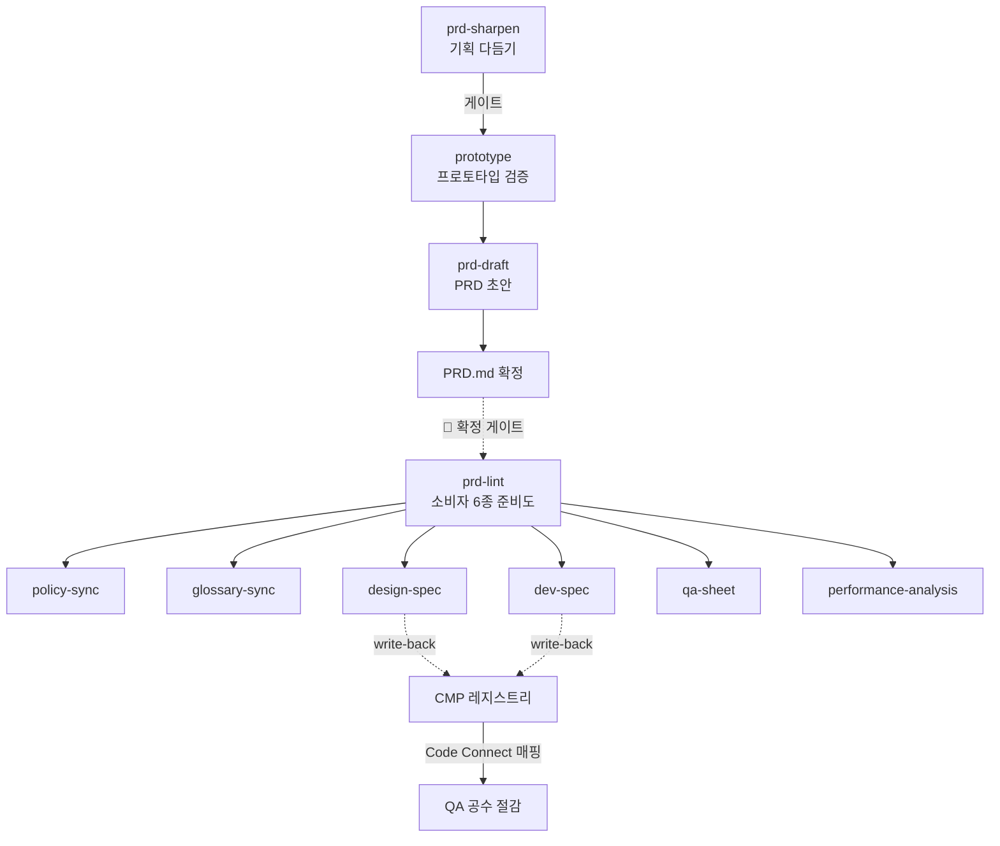

# 제안 — Notion 정본 재구성안

> 대상: [🧱 LifeService UXUI 파이프라인 (Anti-slop & Anti-pattern)](https://app.notion.com/p/3a5a597878a08078b4a1d97c264e9791)
> 작성 2026-08-20 · 🔴 **아직 Notion 에 반영하지 않았다.** 정본 편집은 🙋 HUMAN.
> 원본 fetch 2026-08-18 기준.

## 🔴 반영 전 확인 — 보존해야 하는 것 10개

전면 재구성(`replace_content`)은 `<page>` 태그를 잃으면 **하위 페이지가 삭제된다** (`notion-map.md` § 편집 규칙).
아래가 현재 문서에 걸려 있는 자식들이며, 재구성안은 **전부 유지**한다.

| # | 종류 | 대상 | 새 위치 |
|---|---|---|---|
| 1 | `<page>` | 지면 컨텍스트 스캔 정책 (Step 0) | §2.1 |
| 2 | `<page>` | 기획 의도 파악 · 되묻기 · 설계안 확정 정책 | §2.2 |
| 3 | `<page>` | form · 지면 검수 규칙 | §4.5 |
| 4 | `<page>` | movingHome · 지면 검수 규칙 | §4.5 |
| 5 | `<page>` | movingpartner · 지면 검수 규칙 | §4.5 |
| 6 | `<page>` | UX UI 검수 루브릭 | §5.2 |
| 7 | `<page>` | 공통 · Responsive 레이아웃 정본 | §5.2 |
| 8 | `<database>` | 주요 지면 리스트 & IA 구조 (inline) | §4.4 |
| 9 | `<mention-page>` | Notification ×2 | §5.7 |
| 10 | — | `allow_deleting_content` 는 **절대 켜지 않는다** |

---

## 무엇이 달라지나

| | 현재 (i~vi) | 재구성안 (1~5) |
|---|---|---|
| **목적** | 검수 파이프라인 조회 인덱스 | 🔴 **2목적** — ① 초안 UXUI 퀄리티 검수 ② PRD 목적·맥락 읽고 **시스템 적합 프로토타입으로 재구성** |
| **읽는 순서** | 게이트 → 스캔 → 의도 → 지면 → 공통 → 기타 | **입력 → 해석 → 생성 → 재료 → 규칙** |
| **스킬** | `lifeservice-uxui` 1개 | **3개** — `anti-slop` · `ux-critique` · `lifeservice-uxui` |
| **PRD** | 없음 | 🆕 **§3 전체** — PRD 파이프라인 · ID 4종 · 확정 게이트 · 크리틱 5렌즈 |
| **컴포넌트 role 12종** | 문서에 없음 (캐시에만) | 🆕 §4.3 인덱스 |
| **작업 범위** | W1·W2·W3 (W4 는 각주) | **W1~W4 4종 승격** |
| **레포 구조** | 🔴 3개 파일 누락 (L7) | 교정 |
| **미결** | 없음 | 🆕 §5.6 대장 8건 |

**매핑** — 기존 내용은 하나도 버리지 않는다.

```
i   게이트웨이       → 1.2 · 1.3 · 1.4
ii  지면 스캔         → 2.1
iii 기획 의도         → 2.2 · 2.3 · 2.4
iv  지면별 플로우     → 4.1 · 4.2 · 4.4 · 4.5
v   도메인 공통       → 5.1 · 5.2
vi  기타 참조         → 5.3 · 5.4 · 5.5 · 5.7
                       ↑ 신규: 1.1 전경 · 1.5 스킬 경계 · 3.x 전체 · 4.3 role · 5.6 미결
```

---

# 재구성안 본문

## [callout] 이 문서는 무엇인가

**초안을 받아 시스템에 맞는 프로토타입으로 다시 세우기 위한 조회용 인덱스입니다.**

두 가지를 합니다 — ① 프로토타입 초안의 **UXUI 퀄리티 검수** ② PRD 의 **목적·맥락을 읽고 재구성**.
세부 규칙은 하위 페이지와 스킬 캐시에 있고, 여기서는 **어디를 봐야 하는지**만 정합니다.

🔴 **이 문서가 정본이고 스킬 `references/` 는 캐시입니다.** 충돌하면 이 문서가 이깁니다.
🔴 **값은 한 곳에만 둡니다.** 같은 수치가 두 곳에 있으면 반드시 어긋납니다 — 미러를 둘 때는 "정본은 여기" 를 표기합니다.

---

# 1. 스킬 파이프라인 플로우차트

## 1.1 전경 — 생성부터 소비까지 🆕



🔴 **fan-out 앞에 게이트가 필요하다.** 갈라진 뒤에는 되돌아올 길이 없어 결손이 6갈래로 복제된다.
🔴 **`design-spec` ∥ `dev-spec` 은 병렬인데 재합류 지점이 없다** — QA 공수가 발생하는 자리다. §3.4.

## 1.2 재구성 파이프라인 — 8단계 + 7게이트

*(기존 mermaid 플로우차트 유지)*

## 1.3 게이트 7종

*(기존 표 유지 — G0-a · G0-b · G1~G5)*

## 1.4 담당자 부재 시 — 자율 수정 루프

*(기존 표 유지 — 🔧 AUTO / 💬 PROPOSE / 🙋 HUMAN · 정지 조건 5개)*

## 1.5 스킬 3종 — 무엇을 묻느냐로 가른다 🆕

| 묻는 것 | 스킬 | 산출물 |
|---|---|---|
| "지식을 최신으로" | `anti-slop` | 위키 페이지 · 린트 리포트 |
| **"PRD 가 하려는 걸 이 화면이 하는가"** | `ux-critique` | 크리틱 · 개선안 (수정하지 않는다) |
| "규칙을 어겼는가" | `lifeservice-uxui audit` | punch list (수정하지 않는다) |
| "만들어라 / 고쳐라" | `lifeservice-uxui` W1~W4 | 프로토타입 + 게이트 리포트 |

🔴 **규칙 판정을 두 벌로 만들지 않는다.** `ux-critique` 는 게이트를 **실행해서 인용**한다.

---

# 2. 페이지 의도 추정

**요청문을 유저 행동으로 번역하고, 무엇을 만들려는 것인지 확정하는 단계.**
🔴 질문지를 보내지 않고 **안을 만들어 보낸다** — *"이렇게 만들면 됩니다, 맞습니까?"*

## 2.1 지면 컨텍스트 스캔 (Step 0)

*(기존 ii 표 유지 · `<page>` 유지)*

## 2.2 되묻기 · IntentTag · G0-a 설계안 (Step 1 · 2 · 3.4)

*(기존 iii 표 유지 · `<page>` 유지)*

## 2.3 작업 범위 4종 — W4 승격 🔧

| 범위 | 무엇 | 입력 | 🔴 이것만은 |
|---|---|---|---|
| **W1 신규** | 신규 화면·플로우 초안 | 의도 프롬프트 | 로깅 계약 신설 — 없으면 G5 판단 불가 |
| **W2 추가** | 기존 화면 안에 신규 플로우·기능 | 의도 + 대상 지면 | 재사용 탐색 먼저 |
| **W3 폴리싱** | 기존 페이지 UXUI 정합 | 원본 URL·파일 | 원본 결손 실측 먼저 |
| **W4 그래픽** 🆕 | 맥락에 맞는 그래픽 variants | 의도 + 쓰일 자리 | 장면·사물·인물·사진은 🔴 **생성 금지 → placeholder** |

*(라우팅 코드블록 · 단계별 차이 표 · 승격 2건 유지)*

## 2.4 파이프라인 2종 — 무엇을 막는가가 다르다

*(기존 표 유지 — 🟦 Anti-slop / 🟥 Anti-pattern)*

---

# 3. PRD 기반 프로토타입 생성 지침 🆕

**PRD 의 목적·맥락을 프로토타입으로 옮기는 구간.** 여기가 비어 있으면 규칙만 맞고 목적은 빗나간 화면이 나온다.

## 3.1 PRD.md 정보 구조 — 섹션이 소비자와 1:1

| § | 내용 | 소비자 |
|---|---|---|
| 0 | 목적 6칸 + 🔴 프로토타입 **확정/탐색 구분** | `ux-critique` |
| 1 | 수용 기준 `AC-nn` | policy-sync · qa-sheet · dev-spec |
| 2 | 용어 `TERM-nn` (도메인·UI·코드·로깅 4열) | glossary-sync |
| 3 | 컴포넌트 `CMP-nn` + **write-back 칸** | design-spec ∥ dev-spec |
| 4 | 지표 `MET-nn` + 검증 계약 | performance-analysis |
| 5 | 미결 | — |

🔴 **ID 4종이 조인 키다.** `AC-01` 이 정책 항목 ID · QA 케이스 ID · 테스트 이름이 된다.
🔴 **값이 아니라 참조를 담는다.** `#00A1FF` 대신 `backgroundBrand` — 값을 적으면 Figma·코드·PRD 세 벌이 된다.

## 3.2 확정 게이트 — `prd-lint.js`

소비자 6종별 준비도 · ID 무결성 · 참조 원칙 · write-back 상태.
🔴 **판정하지 않는 것** — AC 내용이 옳은가 · 용어가 적절한가 · 디자인이 목적에 맞는가.

## 3.3 크리틱 — 목적 적합성 5렌즈

| 렌즈 | 묻는 것 |
|---|---|
| **L1** Key Action 도달 | `flow Key Action` 이 PRD 목표와 같은가 |
| **L2** 정보 순서 | 결정 근거가 결정 **앞**에 있는가 |
| **L3** 실패 경로 | 5상태·에러 복구가 있는가 |
| **L4** 측정 가능성 | 성공지표를 `page_id` 로 잴 수 있는가 |
| **L5** 선례 이탈 | 🔴 **다른데 PRD 가 그 차이를 요구하지 않으면 slop** |

🔴 **규칙은 통과하는데 목적을 막는 것**이 이 렌즈의 존재 이유다. 게이트가 구조적으로 못 잡는 자리.

## 3.4 간극이 생기는 자리 — write-back 🔴

| CMP | 역할 | PRD 요구 | 상태 | design-spec (Figma) | dev-spec (코드) | Code Connect |
|---|---|---|---|---|---|---|
| `CMP-01` | `R-GRID` | 요금제 3개 비교 | default·selected·disabled | `node-id: —` | `—` | — |

PRD 확정 시점엔 오른쪽 3칸이 비어 있는 게 정상. **두 단계가 끝나고도 비어 있으면 그때가 차단**이다.
**Code Connect 매핑 없는 신규 컴포넌트 = 스펙 미완** — 이름 파리티를 강제하는 유일한 지점.

> ⚠️ 구조적 파리티(variant·state)는 자동 해법이 없다. **매트릭스로 못 박고 ✅ 1칸 = 스토리 1개**로 잇는다.

## 3.5 디렉토리

```
ux-critique/
├── SKILL.md                    7단계 — 입력 · 맥락 · 증거 · 커버리지 · 렌즈 · 제안 · 핸드오프
├── references/
│   ├── prd-contract.md         PRD 가 담아야 하는 것 (쓰는 쪽)
│   ├── prd-template.md         바로 쓰는 템플릿
│   ├── prd-parse.md            PRD 에서 무엇을 뽑나 (읽는 쪽)
│   ├── lenses.md               목적 적합성 5렌즈
│   ├── proposal.md             제안 카드 · 🔴 슬롭 크리틱 6종
│   └── handoff.md              채택 → W3/W2/G0-b 변환
└── scripts/
    ├── prd-lint.js             PRD.md 확정 게이트
    └── inventory.js            프로토타입이 실제로 하는 것 (관찰, 판정 없음)
```

---

# 4. 시스템 지침 — 화면 패턴 · 컴포넌트 · 레이아웃

**무엇으로 만드는가.** 🔴 **다양성은 여기서 결함이다** — 같은 pattern 의 기존 지면 2개와 **같게** 만든다.

## 4.1 프로젝트 × archetype

*(기존 표 유지 · "정본은 v 레이아웃 정본" 미러 표기 유지)*

## 4.2 화면 패턴 6종

*(기존 표 유지)*

## 4.3 컴포넌트 역할 12종 🆕

**role 이 컴포넌트를 부른다.** *"카드를 넣고 싶다"* 가 아니라 *"이 블록은 `R-GRID` 이므로 카드형이 필요하다"* 순서.

| role | 한 줄 | breakpoint 거동 |
|---|---|---|
| `R-PAGETITLE` | 최상단 큰 제목 | A·B 768 램 승격 / C 고정 |
| `R-TABBAR` | 균등분할 2~5 탭 | XS 탭 h46 → SM+ **nav-rail 160** |
| `R-FILTER` | 칩 가로 나열 | 폭만 신축 · 🔴 선택 강조에 brand 금지 |
| `R-SUMMARY` | 상단 요약·상태·CTA | MD **content-rail 300** |
| `R-LIST` | 동일 구조 3개 이상 반복 | 🔴 **1열 불변 (G5)** |
| `R-GRID` | 균등 n열 | 🔴 **n 불변** · minWidth 폴백만 예외 |
| `R-CAROUSEL` | 가로 스크롤 | 🔴 그리드 전환 금지 (G7) · **ODS 미보유** |
| `R-FORM` | 입력·선택 컨트롤 | 768 → **478 고정 중앙** |
| `R-SECTION` | 제목 + 콘텐츠 — **모호하면 이것** | 폭 · gutter · padY 만 |
| `R-CTA-BOTTOM` | 최하단 폭 전체 버튼 | 컨테이너 폭 추종 (G9) |
| `R-UICG` | UI 컴포지션 그래픽 | 🔴 **LandingPage 전용** |
| `R-CHROME` | GNB · statusbar | 🔴 **구현하지 않는다 (G14)** |

**해소 사다리** — ① ODS 카탈로그 → ② 로컬 스토리북 298 → ③ 신규(🔴 G0-b 승인 필수).
🔴 **읽기 전 생성 금지.** 이름만 보고 API 를 추정하지 않는다.

**실제 중복 3건** — `StickyCta` 3벌(정본 `LandingStickyCta`) · `PartnerCard` 2벌(구분 유지) · step shell 2벌(⚠️ 미확정).

## 4.4 지면 리스트 & IA 구조 (정본 DB)

*(inline `<database>` 유지)*

## 4.5 프로젝트별 지면 검수 규칙

🔴 **해당 프로젝트 1개만 읽는다.** 3개 다 읽는 것이 전형적인 낭비다. *(`<page>` 3개 유지)*

---

# 5. 세부 참조 — policy · system 축별

## 5.1 도메인 공통 지침 — 영역 → 어디

*(기존 v 표 유지)*

## 5.2 정본 2건

*(`<page>` 2개 유지 — 루브릭 · 레이아웃 정본)*
**위계** — 레이아웃 정본 **L0** → 프로젝트 규칙 **L1** → 절차 **L2** → 판정 **L3**.
🔴 **정본이 절차를 이기고, 절차가 판정을 이긴다.**

## 5.3 소스 레지스트리

*(스토리북 · Figma ×2 · ODS 유지)*
⚠️ **버전 드리프트 주의** — MCP 검증 카탈로그(design-system 13.2.4)와 오프라인 설치본(11.5.1)이 다르다.
🔴 **빈 카탈로그의 "없다" 를 근거로 쓰지 않는다** (미결 O-4 가 이 함정에서 나왔다).

## 5.4 자동 스크립트

| 스크립트 | 판정 | 스킬 |
|---|---|---|
| `gate-static.js` | 5폭 측정 — G1~G4 · G3-D · C3·C5·C8 · 가드레일 · 그래픽 33% · CTA 총량 · Primary 면적 | lifeservice-uxui |
| `gate-loop.js` | 이터레이션 — 회귀·무효 수정 감지 · AUTO/PROPOSE/HUMAN · 정지 판정 | lifeservice-uxui |
| `audit-layout.js` 🔧 | 전수검사 L1~L10 — 레이아웃·글리프·ODS 토큰 (W4용) | lifeservice-uxui |
| `prd-lint.js` 🆕 | PRD.md 확정 게이트 — 소비자 6종 준비도 | ux-critique |
| `inventory.js` 🆕 | 프로토타입 인벤토리 — 골격·CTA·상태·로깅·그래픽 (관찰) | ux-critique |
| `wiki-lint.js` 🆕 | 위키 건강검진 — 모순·stale·고아·끊긴 링크 | anti-slop |

## 5.5 스킬 레포 구조 🔧 교정

🔴 **아래 3개가 현재 문서 트리에서 누락돼 있었다** — 정본이 캐시보다 뒤처진 상태(역방향 드리프트).

```
lifeservice-uxui/
├── SKILL.md
├── references/
│   │  ── 인덱스 (이름만 고르고 1개만 로드) ──
│   ├── work-scopes.md            🔧 누락분 — 파이프라인 2종 · 범위 4종
│   ├── macrostructures.md        → macrostructures/01-landingpage.md … 06-chatchannel.md
│   ├── components.md             → components/r-pagetitle.md … r-chrome.md
│   │  ── 축별 참조 ──
│   ├── color.md  typography.md  layout-and-space.md  responsive.md
│   ├── assets.md  imagery-kit.md  hero-kv-prompt.md  🔧 누락분
│   ├── interaction-and-states.md  motion.md
│   ├── design-md.md  preview-examples.md  slop-test.md  rubric.md
│   │  ── 운영 ──
│   ├── page-catalog.md  gate-loop.md  open-decisions.md
│   ├── sources.md  slack-adapter.md  notion-map.md
│   └── verbs/  plan.md · audit.md · sync.md
└── scripts/
    ├── gate-static.js  gate-loop.js
    └── audit-layout.js           🔧 누락분
```

## 5.6 미결 대장 🆕 — 8건

| ID | 항목 | 막히는 것 | 분류 |
|---|---|---|---|
| **O-1** | Form progressbar 분모 불일치 | **R10 판정 자체가 불가** | 🙋 |
| **O-2** | archetype C 폭 478 vs 560 | G2 · G9 판정이 갈림 | 💬 |
| **O-3** | 타이포 램 ↔ ODS textStyle 매핑 부재 | *"타이포는 ODS 토큰으로만"* 이 **지켜질 수 없다** | 🙋 |
| **O-4** | `Card` ODS 미보유 판정이 오탐 가능성 | `R-GRID`·`R-SUMMARY` primitive 강제 근거 상실 | 🙋 |
| **O-5** | UICG 재료 수 6벌 (실측 15 · 13 · 19 · 24 · 21) | UICG 인용 시 값 불명 | 💬 |
| **C8** | knowledge 어휘 ↔ ODS API 매핑표 | G1 · R7 자동화 불가 | 🟢 |
| **C9** | R2 · R3 임계값 | 판정 기준 공백 | 🟢 |
| **F2** | G0-a · G0-b · G4 담당자 미지정 | 사람 게이트에 대기만 쌓임 | 🔴 |

🔴 **미결이 0건이 아닌 산출물을 "게이트 통과" 로 쓰지 않는다.**

## 5.7 Notification

*(`<mention-page>` 2개 유지)*
